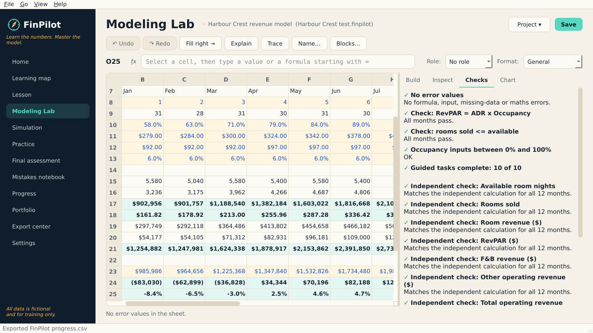
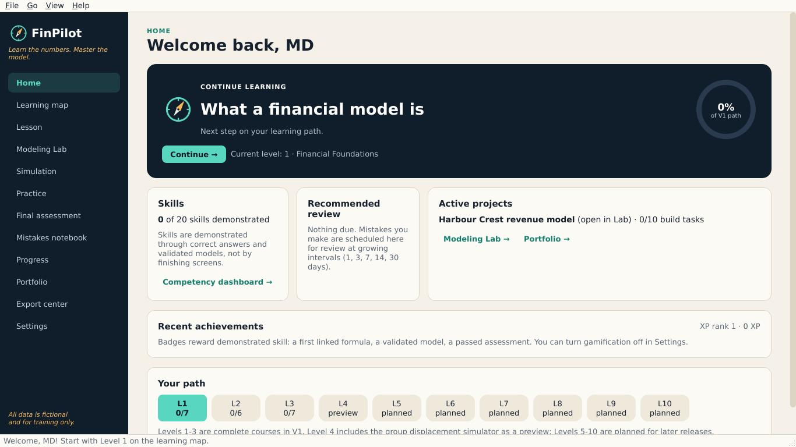
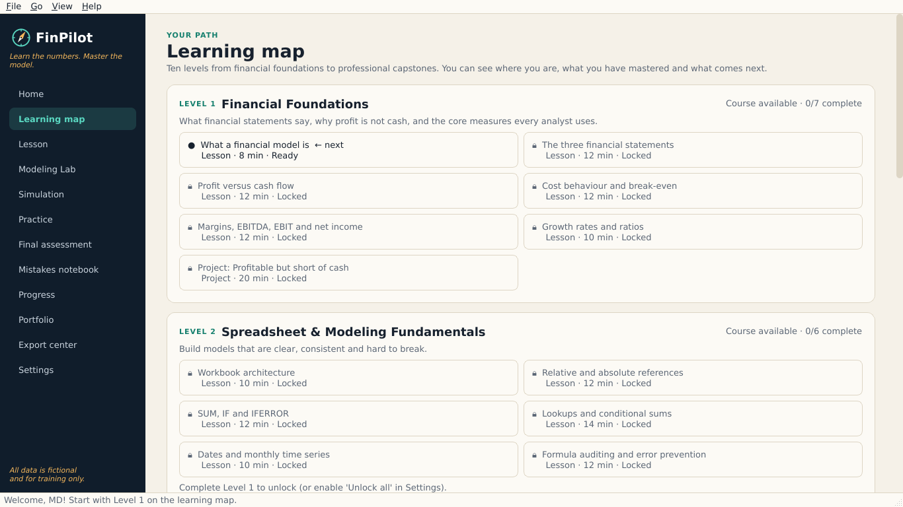
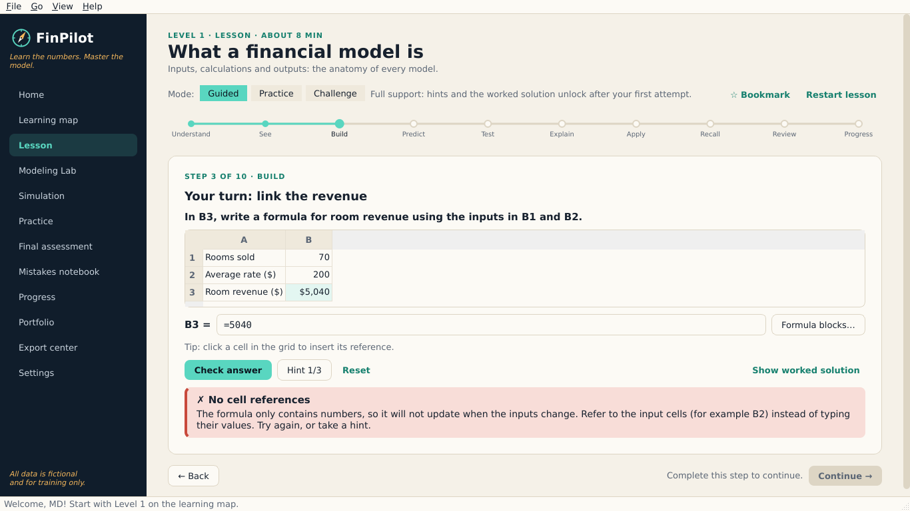
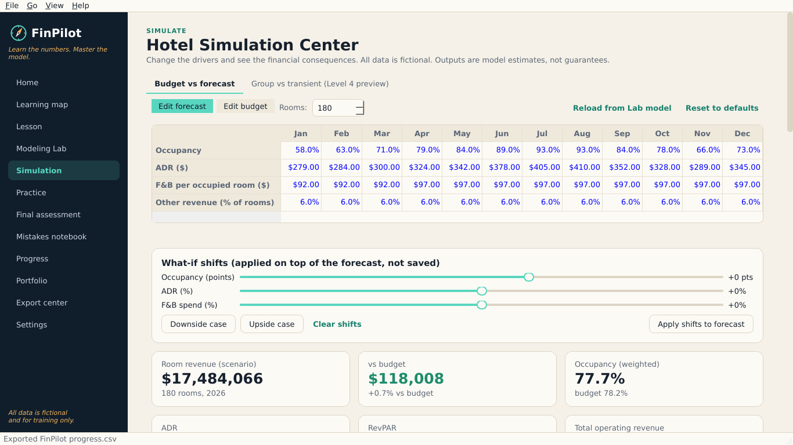
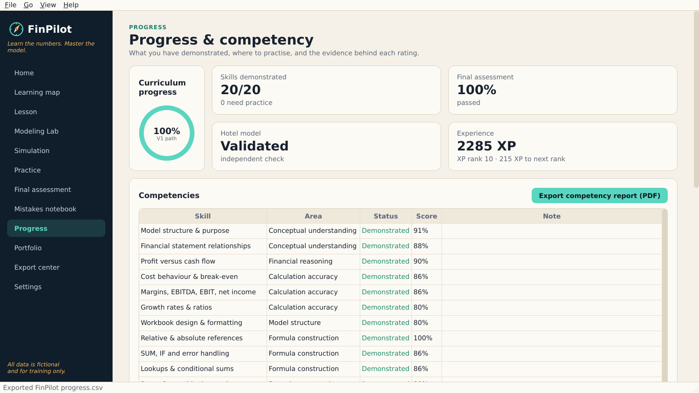
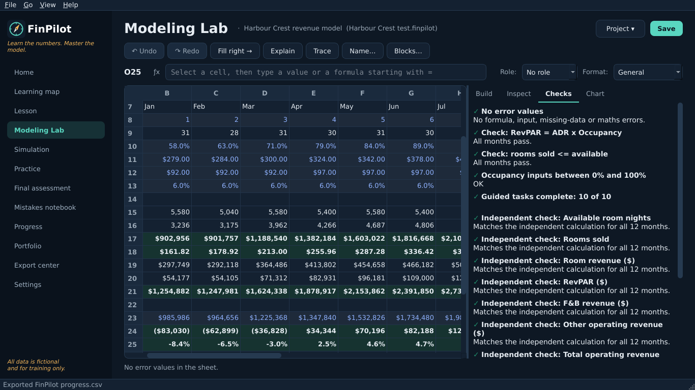
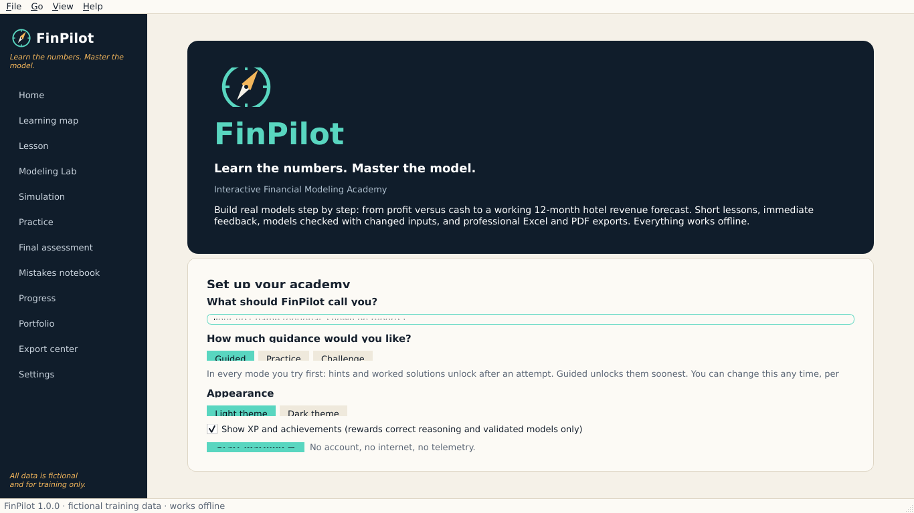

<div align="center">


# FinPilot

**Learn the numbers. Master the model.**

An interactive financial modeling academy for Windows. You build real models step by step and get
immediate, specific feedback. It works fully offline.

[](https://github.com/mutima89/finpilot/actions/workflows/windows-build.yml)
-0B1F33)

-1F8A7A)


[](LICENSE)

[Download](#download) · [Features](#features) · [Screenshots](#screenshots) · [Build from source](#build-from-source) ·
[Architecture](#architecture) · [Roadmap](#roadmap)



</div>

---

## Why FinPilot

Most people learn financial modeling by copying someone else's spreadsheet. FinPilot makes you **build** the
model yourself, and checks the result the way a reviewer would.

- **Behavioural grading.** Your formulas are re-run with changed inputs, so typed numbers, hard-coded
  constants and missing `$` anchors are caught even when today's value looks right.
- **Feedback that teaches.** Wrong answers are diagnosed (percent scale, sign, rounding, inverted ratios,
  known mistakes). Hints and worked solutions unlock only after you've made an attempt.
- **Real deliverables.** It exports Excel workbooks with live formulas (not pasted values) and PDF reports.
- **Private by design.** There's no account, no internet connection and no telemetry. Your data stays in
  `%APPDATA%\FinPilot`.

> All companies, hotels and figures in FinPilot are **fictional** and for training only.

## Download

Every push to `main` builds and self-tests the Windows app on GitHub Actions.

1. Open the latest successful [**Windows build** run](https://github.com/mutima89/finpilot/actions/workflows/windows-build.yml).
2. Under **Artifacts**, download one of these:
   - **FinPilot-Setup-win64**: the installer `FinPilot-Setup-1.0.0.exe`. It installs per user and needs no
     admin rights.
   - **FinPilot-portable-win64**: a folder you can run without installing (`FinPilot.exe`).
3. The app isn't code-signed yet. If Windows shows *"Windows protected your PC"*, click **More info**, then
   **Run anyway**.

## Features

| Area | What you get |
|---|---|
| **Learning path** | A 10-level map. Levels 1-3 are complete courses (18 lessons + 2 projects): financial foundations, spreadsheet fundamentals and hotel revenue. Level 4 has a working preview. |
| **Lesson engine** | 10 steps per lesson: Understand, See, Build, Predict, Test, Explain, Apply, Recall, Review, Progress. Three modes (Guided, Practice, Challenge), bookmarks and resume. |
| **Modeling Lab** | A spreadsheet workspace where you build the 12-month *Harbour Crest Hotel* model in 10 guided tasks. It includes undo/redo, fill right, explain cell, trace precedents and named ranges, plus autosave and recovery. |
| **Formula engine** | A safe parser and evaluator for 56 Excel functions (no `eval`). It follows Excel precedence, handles relative and absolute references, and returns explicit errors (`#DIV/0!`, `#REF!`, `#CIRC!`, `#UNSUPPORTED!`...). |
| **Simulation Center** | Budget vs forecast, what-if sliders and presets, KPI tiles and charts. Also a revenue bridge that reconciles exactly, a sensitivity grid, and group vs transient displacement with a break-even rate. |
| **Practice & assessment** | 13 randomised formula drills and an 18-item final practical assessment in 6 sections, with a per-section report. |
| **Retention** | A mistakes notebook with spaced review (1, 3, 7, 14 and 30 days). Three correct reviews in a row resolve an item. |
| **Progress** | A competency dashboard with 20 skills rated from evidence, plus a portfolio. Badges reward validated work only, can be switched off, and come with no streaks or timers. |
| **Exports** | An Excel workbook with live formulas (Model, Scenarios with charts, Bridge, Checks, Recommendation), a project PDF, a competency PDF and progress CSV/JSON. |
| **Comfort** | Light and dark themes, branded onboarding, backup/restore and a database integrity check. |

## Screenshots

<table>
  <tr>
    <td width="50%"><br><sub><b>Home.</b> Continue where you left off, plus skills, reviews and projects.</sub></td>
    <td width="50%"><br><sub><b>Learning map.</b> Ten levels, with prerequisites and progress.</sub></td>
  </tr>
  <tr>
    <td><br><sub><b>Lessons.</b> Specific feedback on what went wrong and why.</sub></td>
    <td><br><sub><b>Simulation Center.</b> Scenarios, KPIs, bridge and sensitivity.</sub></td>
  </tr>
  <tr>
    <td><br><sub><b>Progress.</b> Competencies rated from evidence, not screens visited.</sub></td>
    <td><br><sub><b>Dark theme.</b> The Modeling Lab after dark.</sub></td>
  </tr>
  <tr>
    <td colspan="2" align="center"><br><sub><b>Onboarding.</b> Your name, guidance mode, theme and XP preference.</sub></td>
  </tr>
</table>

## Build from source

**Requirements:** Python 3.12 (64-bit) on Windows 10/11. Python 3.11+ also works for running from source on
macOS/Linux.

```powershell
# Run the app
py -3.12 -m venv .venv
.venv\Scripts\activate
pip install -r requirements.txt
set PYTHONPATH=src
python -m finpilot
```

```powershell
# Run the tests
pip install -r requirements-dev.txt
python -m pytest tests
```

```powershell
# Build FinPilot.exe and the installer (Inno Setup 6 optional)
powershell -ExecutionPolicy Bypass -File build\build_windows.ps1
```

The build script does seven things:
1. Creates a clean virtual environment.
2. Installs the pinned dependencies.
3. Runs the full test suite.
4. Builds `dist\FinPilot\FinPilot.exe` with PyInstaller.
5. Runs the packaged app's headless self-test (`FinPilot.exe --self-test <folder>`).
6. Builds `dist\installer\FinPilot-Setup-1.0.0.exe` if Inno Setup is installed.
7. Writes SHA-256 checksums.

[`.github/workflows/windows-build.yml`](.github/workflows/windows-build.yml) runs the same script in CI.

## Architecture

```
src/finpilot/
  core/          formula engine, sheet model + dependency graph, finance, hotel model, revenue management
  curriculum/    content (JSON), loader/validator, grading, progression, hotel project checker, drills
  data/          SQLite progress database, .finpilot project files (checksummed, .bak on save)
  export/        Excel (openpyxl, live formulas) and PDF (ReportLab)
  ui/            PySide6 app: theme, widgets, spreadsheet grid, main window, 12 screens
tests/           pytest suite, including an end-to-end learner journey through the real widgets
build/           PyInstaller spec, Windows build script, version info, Inno Setup script
docs/            architecture, formula reference, limitations, troubleshooting, test report
```

**Stack:** Python 3.12 · PySide6 (Qt 6) · openpyxl · ReportLab · matplotlib · SQLite · PyInstaller · Inno Setup

## Quality

- **158 automated tests.** They cover the formula engine, the sheet model and finance/hotel maths, checked
  against independent hand calculations. They also cover grading, curriculum integrity, progression, the
  database (including corruption and restore), project files, and Excel/PDF exports. The UI tests render every
  screen at four window sizes and drive a **complete learner journey**.
- **Exported workbooks are recalculated independently** with LibreOffice, and every formula cell matches
  FinPilot's values.
- **On Windows (CI),** the suite passes with the native Qt platform, and the packaged exe passes its five-point
  self-test.

Full details are in [docs/TEST_REPORT.md](docs/TEST_REPORT.md).

## Documentation

| Document | Contents |
|---|---|
| [Architecture](docs/ARCHITECTURE.md) | Modules, data flow, design decisions |
| [Formula reference](docs/FORMULA_REFERENCE.md) | Supported functions, operators and errors |
| [Known limitations](docs/KNOWN_LIMITATIONS.md) | What V1 does not do yet |
| [Troubleshooting](docs/TROUBLESHOOTING.md) | Build and runtime problems, and where data lives |
| [Requirements checklist](docs/CHECKLIST.md) | V1 scope and status |
| [Test report](docs/TEST_REPORT.md) | What was tested, where, and the results |

## Roadmap

- [x] **V1:** Levels 1-3, the 12-month hotel model, scenarios, Excel export, the final assessment, and the Windows build
- [ ] Level 4: revenue management (full course; the displacement simulator preview ships today)
- [ ] Levels 5-10: the full P&L, cash flow, three-statement models, valuation and capstones
- [ ] A code-signed installer

## License

[MIT](LICENSE) © 2026 M A Almahlaki
